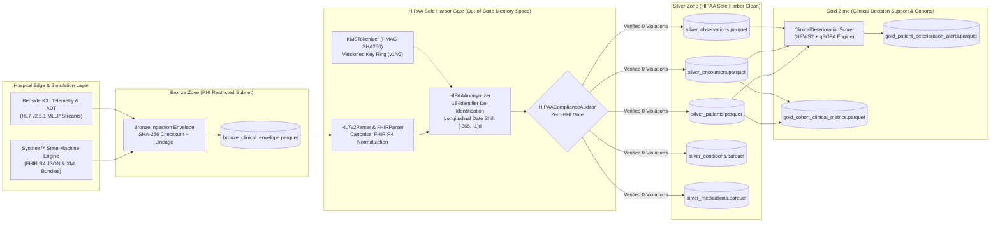

# System Architecture — Healthcare Clinical Interoperability Lakehouse

> **Architectural Blueprint:** Multi-Hop Medallion Lakehouse (`Bronze` → `Silver` → `Gold`) for Real-Time HL7 v2.5.1 & HL7 FHIR R4 Clinical Streams with HIPAA Safe Harbor De-Identification and Stateful NEWS2/qSOFA Scoring.

---

## 1. High-Level Architectural Topology

The platform enforces a strict **Zero-Trust Security Boundary** between the **Raw PHI Landing Zone (Bronze)** and the **De-Identified Research & Alerting Zones (Silver & Gold)**.

---

## 2. Medallion Zone Storage Contracts & Schemas

### 2.1 Bronze Zone (`bronze/bronze_clinical_envelope.parquet`)
Captures the exact byte/string representation of every incoming clinical message prior to parsing, ensuring 100% replayability if downstream vocabulary mappings evolve.

| Column | PyArrow Type | Description |
| :--- | :--- | :--- |
| `envelope_id` | `string` | Unique envelope key (`brz-<seq>-<sha256_prefix>`) |
| `source_system` | `string` | Emitting system (`SYNTHEA_FHIR_GATEWAY`, `ICU_MLLP_MONITOR`, etc.) |
| `protocol` | `string` | Wire format (`FHIR_JSON`, `FHIR_XML`, `HL7V2`) |
| `message_type` | `string` | Message trigger (`Bundle`, `ADT^A01`, `ORU^R01`) |
| `ingested_at_utc` | `string` | ISO-8601 UTC ingestion watermark |
| `payload_sha256` | `string` | Cryptographic SHA-256 hex digest of `raw_payload` |
| `raw_payload` | `string` | Unmodified raw HL7 v2 or FHIR R4 payload |

### 2.2 Silver Zone (`silver/*.parquet`)
Contains canonical, relational HL7 FHIR R4 entities after passing [`HIPAAAnonymizer`](../../src/healthcare_lakehouse/security/hipaa_anonymizer.py) and [`HIPAAComplianceAuditor`](../../src/healthcare_lakehouse/security/hipaa_anonymizer.py):

- **`silver_patients.parquet`:** `patient_token`, `mrn_token`, `gender`, `birth_year` (shifted, or capped for age `90+`), `age_years` (top-coded at `90`), `state`, `postal_code_zip3` (`"000"` for restricted prefixes), `scrubbed_clinical_note`.
- **`silver_encounters.parquet`:** `encounter_token`, `patient_token`, `status`, `encounter_class` (`ICU`, `IMP`, `EMER`, `AMB`), `facility_id`, `period_start_iso` (shifted).
- **`silver_observations.parquet`:** `observation_token`, `patient_token`, `encounter_token`, `loinc_code`, `display`, `numeric_value`, `string_value`, `unit`, `effective_datetime_iso` (shifted).
- **`silver_conditions.parquet`:** `condition_token`, `patient_token`, `encounter_token`, `code` (ICD-10-CM / SNOMED-CT), `display`, `onset_datetime_iso` (shifted).
- **`silver_medications.parquet`:** `medication_token`, `patient_token`, `encounter_token`, `rxnorm_code`, `display`, `dosage_text`, `authored_on_iso` (shifted).

### 2.3 Gold Zone (`gold/*.parquet`)
- **`gold_patient_deterioration_alerts.parquet`:** Real-time clinical acuity records containing `patient_token`, `encounter_token`, `evaluated_at_iso`, `news2_score` (`0..20`), `qsofa_score` (`0..3`), `risk_level` (`LOW`, `LOW_MEDIUM`, `MEDIUM`, `HIGH`), `sepsis_suspected` (`bool`), `recommended_response`, and `triggered_parameters`.
- **`gold_cohort_clinical_metrics.parquet`:** Research aggregations grouped by `(gender, encounter_class)` reporting `patient_count`, `mean_news2_score`, `max_news2_score`, and `suspected_sepsis_cases`.

---

## 3. Epidemic / Pandemic Surge Scalability Architecture

Under epidemic surge conditions (e.g., 25x ICU bed occupancy and continuous 1 Hz bedside vital sign emission):
1. **Zero-Lock Deterministic Pseudonymization:** `KMSTokenizer` uses in-memory HMAC-SHA256 with cached KMS data keys rather than a stateful database lookup table, allowing 100% parallel execution across Apache Spark / PyArrow workers.
2. **Columnar Vectorization & ZSTD Compression:** `pyarrow.Table.from_pylist` with `ZSTD` compression achieves sub-millisecond batch writes and high compression ratios on repetitive LOINC/SNOMED URIs.
3. **Partition Strategy for Petabyte Scale:** In distributed Spark/S3 deployments, Silver and Gold Parquet datasets partition by `(encounter_class, event_year_month)` and bucket by `patient_token` (64 buckets) to enable sort-merge joins without network shuffle skew.
