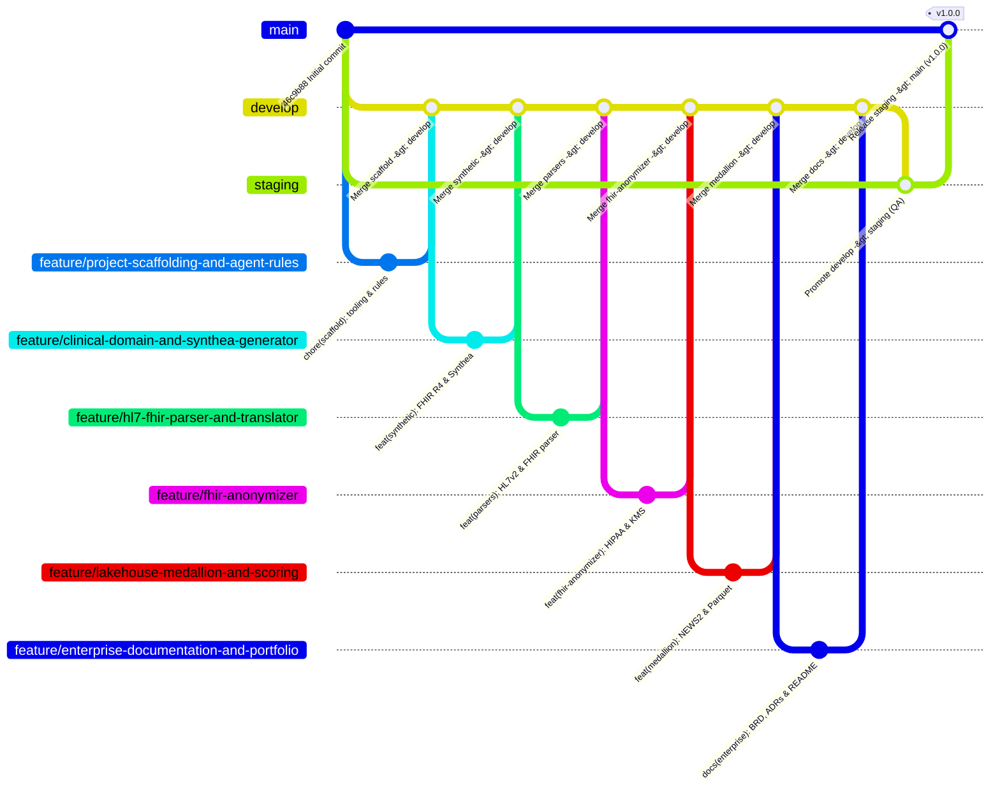

# Enterprise Gitflow, Branching & Worktree Governance

> **Governance Standard:** Protected Multi-Environment Promotion (`feature/*` → `develop` → `staging` → `main`) with Automated Lefthook Pre-Commit/Pre-Push Gates and GitHub Actions CI/CD.

---

## 1. Branch Promotion Topology



---

## 2. Environment Branch Responsibilities

| Branch | Environment Role | Protection & Promotion Rules |
| :--- | :--- | :--- |
| **`feature/<scope>`** | Isolated feature / module development | Branched from `develop`; must pass `ruff`, `mypy --strict`, and `100% pytest coverage` before `--no-ff` merge into `develop`. |
| **`develop`** | Continuous Integration trunk | Integrates completed `feature/*` branches; verified continuously by GitHub Actions. |
| **`staging`** | Pre-Production QA & HIPAA Compliance Sign-Off | Promoted from `develop` via `--no-ff` merge; verified in isolated Git worktree (`.worktrees/staging-qa`) and end-to-end HIPAA audit CLI. |
| **`main`** | Production release branch | Direct commits to `main` are blocked by `lefthook.yml` (`protect-main-branch`); receives only verified `--no-ff` release promotions from `staging`. |

---

## 3. Using Git Worktrees for Isolated QA Verification

To validate `staging` or parallel `feature/*` branches without disturbing your active working directory:

```bash
# Create an isolated worktree for staging QA inside gitignored .worktrees/
git worktree add .worktrees/staging-qa staging

# Run full verification inside the isolated worktree
cd .worktrees/staging-qa
uv run --no-sync pytest
uv run --no-sync healthcare-lakehouse run-pipeline --patients 10 --verify-hipaa

# Clean up worktree after verification
cd ../..
git worktree remove .worktrees/staging-qa
```
